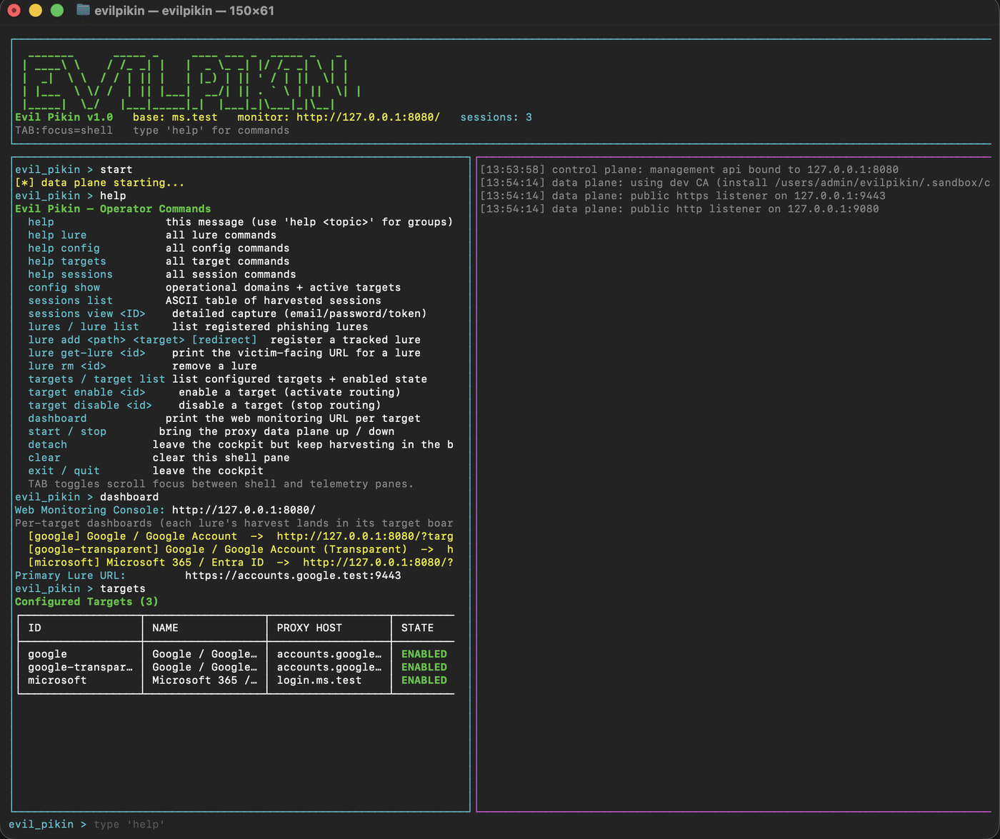
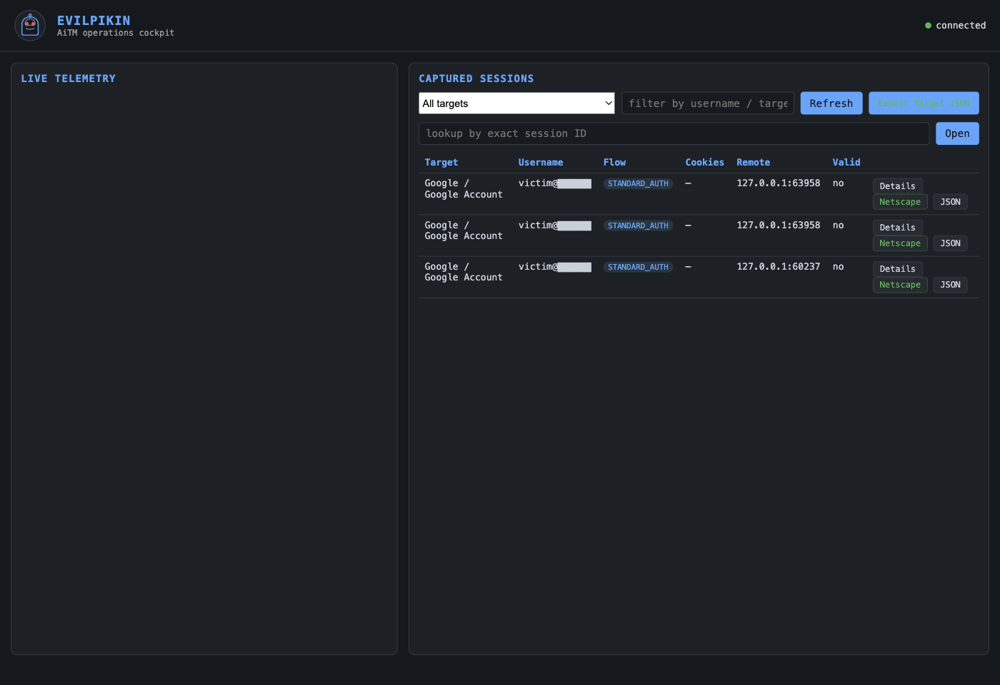

<p align="center">
  
</p>

<h1 align="center">evilpikin</h1>

<p align="center">
  <b>An independent, open-source Adversary-in-the-Middle (AiTM) phishing framework in Go —<br>
  built to teach, demonstrate, and study how identity attacks really work, and how to stop them.</b>
</p>

<p align="center">
  <a></a>
  
  
  
  
</p>

---

> ### ⚠️ READ THIS BEFORE ANYTHING ELSE
>
> **evilpikin is an educational and defensive-research tool. It is not a weapon and not for sale.**
> It exists so security engineers, teachers, red teams, and defenders can *see*, *observe*, and *measure* an Adversary-in-the-Middle attack end-to-end — the exact tradecraft real phishing campaigns use and how to stop it.
>
> **What this means, concretely:**
> - Use it **only** inside explicitly authorized scope: a written engagement, your own lab, an isolated test network, or a CTF-style exercise.
> - **Never** against accounts, credentials, and systems you do not own or lack written permission to test.
> - **Never** for credential harvesting of real people, unsolicited phishes, account takeover, or any non-consensual activity.
> - The authors assume **zero** liability for misuse. If you did not obtain authorization first: this tool is not for you.
>
> **What it does not do:** it is not turnkey malware, it does not phone home, it does not bypass anti-fraud systems on your behalf, and it makes no promise that any target will "work" — products and IdPs evolve faster than any test harness can keep up.

---

## Why this exists

Every identity breach post-mortem has the same shape: someone trusted a page that looked like their IdP, and the session walked out the door. Defenders cannot fix what they have never seen. evilpikin exists to make that attack shape visible, measurable, and teachable.

It is a vehicle for:

- **Security education** — showing teams, students, and engineers exactly how a phishing campaign intercepts a sign-in, mints a session, and walks off with it.
- **Defensive engineering** — measuring whether your detection, MFA, conditional-access, and token-binding controls actually hold against the real attack shape, not a PowerPoint.
- **Adversary simulation** — an authorized red team measuring real-world resilience of an organization's identity controls, under NDA, on consented scope.
- **Ark Systems integration** — feeding a simulation into **ARK**, where an assessor can reconstruct the attack, understand *why* each step worked, and generate concrete mitigations (phishing-resistant MFA, anti-phishing policy, token hardening, and response playbooks).

---

## What it actually does

```
v victim browser ──TLS──▶  evilpikin (reverse proxy)  ──TLS──▶  real IdP
                                │
                ├─ routing matrix  : host → host rewrite (victim never leaves the proxy)
                ├─ transformer     : HTML/JS/CSS host rewriting + cookie-domain shim
                ├─ CookieJar      : captured credentials / cookies / OTP per session
                ├─ telemetry      : live event stream (WebSocket) + TUI cockpit + dashboard
                └─ lure           : tracked URLs (/login?id=…), per-lure hit counters
```

- **Reverse-proxy phishlets** driven by per-target JSON profiles — Microsoft 365 / Entra ID and Google.
- **Per-host dev-CA TLS**, wildcard DNS stub, per-SNI leaf cert issuance — self-contained lab, no external PKI.
- **Live capture** of username / password / OTP / session cookies, persisted with full telemetry logs.
- **Evilginx-compatible session export** (Cookie-Editor JSON) for post-capture analysis.
- **Multi-target runtime** — serve Microsoft and Google phishlets from one instance.
- **TUI cockpit** + **web dashboard** + **REST/WebSocket control plane**.

## What's real, what's not

Honesty is the whole point of this project. Current state, measured against the code and reproducible in your own lab:

| Capability | Status |
|---|---|
| Microsoft 365 sign-in flow served through the proxy (page renders, CDN assets resolve, form posts, credentials captured) | ✅ demonstrable |
| Session-cookie capture & export (Cookie-Editor JSON / Netscape) | ✅ demonstrable |
| Multi-target concurrent runtime (Microsoft + Google profiles) | ✅ implemented |
| Google sign-in end-to-end capture | ❌ **blocked by Google's Botguard / anti-automation** — see [Findings](docs/google-setup.md) and [Botguard status](#google-and-botguard--what-we-learned) |
| Microsoft full post-auth dashboard access | ⚠️ partially verified; see [microsoft-setup.md](docs/microsoft-setup.md) |
| Production hardening (HSM-grade storage, multi-tenant isolation, rate limits) | ❌ not present — lab-grade only |

> **Google and Botguard — what we learned**
>
> Google's client-side anti-automation (Botguard v3) evaluates the *visiting browser's* fingerprint before it will let the sign-in flow proceed — before any password is typed, at the identifier prompt itself. That is not a bug in evilpikin; it is the security model of modern anti-fraud systems. The correct takeaway is a **finding, not a failure mode**: modern anti-fraud systems bind the sign-in flow to the visiting environment itself. Phishing-resistant MFA (FIDO2/WebAuthn) defeats the attack when the phishing site cannot produce an authentic challenge context.

## Features

- **Routing matrices** — per-target host→host rewrite tables with full-chain coverage (CDN, auth-flow, post-auth navigation).
- **Dynamic aliasing** — external hosts referenced in-page are auto-aliased to phish-subdomains and proxied, no pre-listing required.
- **Cookie capture shim** — JS-set correlation cookies (`uaid`, `MSPCID`, …) rewritten to the phishing site domain.
- **Telemetry** — session start/end, capture events, per-lure hits, real-time stream to TUI and dashboard.
- **Lures** with hit counters and optional `require_lure` + scanner/crawler shield (decoy for bots).
- **Strict-loopback by default** — refuses non-loopback binds without `-public`.
- **Sandboxed state** — DB, dev CA, keys, captures isolated in `.sandbox/` (gitignored, never committed).
- **No external service dependencies** — fully self-contained lab runtime.

## ARK integration — the interesting part

evilpikin is not just a phishing proxy. Wired into **ARK (Cybersecurity Super Intelligence)**, a completed simulation becomes an *evidence chain*:

1. **The capture** is recorded — lure, target, flow, cookies, telemetry, and who/what was touched.
2. **ARK ingests it** — sessions are linked to the case, with full provenance and SHA-256 custody hashing.
3. **ARK assesses it** — *how did this attack succeed? which control failed? what should have stopped it?*
4. **ARK proposes mitigations** — phishing-resistant MFA, conditional access, session TTL, token binding, DNS-resolver monitoring for intercept domains, CT alerting, user awareness guidance — in other words, a measurable path from attack to defense.

That is the difference between "we got owned" and "we now know exactly why, and what closes it."

## Screenshots

| TUI cockpit | Web monitoring console |
|---|---|
|  |  |

## Quick start (local lab)

Requirements: Go 1.26+, a browser profile that trusts the dev CA (`.sandbox/certs/dev-ca.pem`), and an authorized lab scope.

```sh
go build -o evilpikin ./cmd/evilpikin
./evilpikin --no-tui          # loopback-only dev instance
ls -la ~/.sandbox              # isolated state (never commit)
```

Then open the monitoring console (`http://127.0.0.1:8080/`), add a lure in the TUI (`lure add …`), and walk someone through the attack inside your authorized scope. See [docs/microsoft-setup.md](docs/microsoft-setup.md) for a canonical setup path.

## Architecture (short)

- `cmd/evilpikin/` — unified binary: engine + TUI cockpit + DNS stub (loopback-default).
- `internal/proxy/` — reverse proxy, routing, response transformer, CookieJar, capture pipeline.
- `internal/pki/` — dev CA + per-SNI leaf issuance (lab only).
- `internal/dns/` — wildcard DNS answers for phish subtrees.
- `internal/control/` — REST API + WebSocket telemetry; serves `web/` dashboard.
- `internal/storage/` — SQLite models: targets, lures, captured sessions.
- `configs/targets/` — JSON phishlet profiles (Microsoft, Google).

Full detail in [docs/](docs/).

## What this will become

- **A teaching artifact** — the demo where "the phish was real" stops being abstract.
- **A mitigation engine** — deeper ARK integration: automated control-gap analysis and remediation playbooks from each captured session.
- **A public, honest reference** — reproducible results, clear failure modes, and no marketing dressed as capability.

## Legal & ethical use — non-negotiable

By using, forking, or modifying this software you agree:

1. You will only run it against systems you own or have explicit written authorization to test.
2. You will not use it to obtain any credential, account, or data belonging to a person who has not consented.
3. You will not market it, sell it, or operate it as a service against targets you do not control.
4. Captured evidence is sensitive material; store and dispose of it lawfully.
5. You understand the authors are **not** responsible for your actions.

If you cannot accept these terms, do not use this software.

## Further reading

- [docs/microsoft-setup.md](docs/microsoft-setup.md) — Microsoft 365 target, setup & verification notes
- [docs/google-setup.md](docs/google-setup.md) — Google target & Botguard analysis
- [docs/cookie-editor-import.md](docs/cookie-editor-import.md) — replaying a captured session

## License

This project is licensed under the [MIT License](LICENSE).

Copyright (c) 2026 UncleT-cyber

Permission is hereby granted, free of charge, to any person obtaining a copy
of this software and associated documentation files (the "Software"), to deal
in the Software without restriction, including without limitation the rights
to use, copy, modify, merge, publish, distribute, sublicense, and/or sell
copies of the Software, and to permit persons to whom the Software is
furnished to do so, subject to the following conditions:

The above copyright notice and this permission notice shall be included in all
copies or substantial portions of the Software.

THE SOFTWARE IS PROVIDED "AS IS", WITHOUT WARRANTY OF ANY KIND, EXPRESS OR
IMPLIED, INCLUDING BUT NOT LIMITED TO THE WARRANTIES OF MERCHANTABILITY,
FITNESS FOR A PARTICULAR PURPOSE AND NONINFRINGEMENT. IN NO EVENT SHALL THE
AUTHORS OR COPYRIGHT HOLDERS BE LIABLE FOR ANY CLAIM, DAMAGES OR OTHER
LIABILITY, WHETHER IN AN ACTION OF CONTRACT, TORT OR OTHERWISE, ARISING FROM,
OUT OF OR IN CONNECTION WITH THE SOFTWARE OR THE USE OR OTHER DEALINGS IN THE
SOFTWARE.

---

<p align="center"><sub>evilpikin — understand the attack, end it.</sub></p>
